# one-glance

**AI output has to be understood at a glance.** Any model, any tool, any use case.

If a person needs more than a few seconds to know what the AI found, the output failed.
Length, format and medium are tools. The glance is the goal.

<p align="center">
  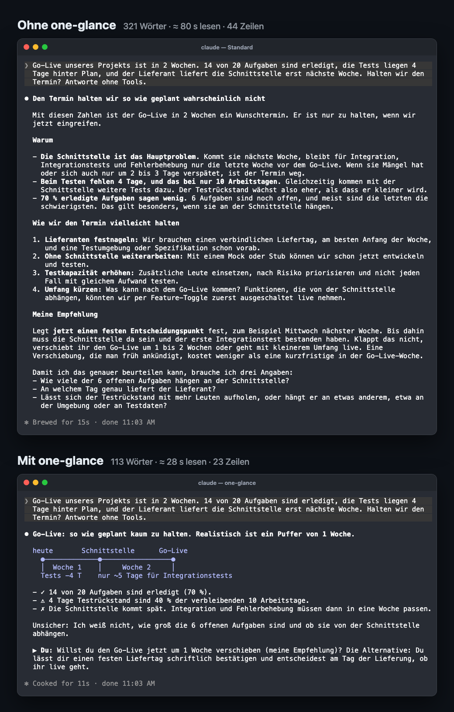
</p>
<p align="center"><sub>Same prompt, real Claude Code output (German). Top: default, 321 words, about 80 s to read. Bottom: one-glance, 113 words, answer in line 1.</sub></p>

## Install

Claude Code, macOS or Linux, needs `git` and `python3`:

```sh
git clone https://github.com/Flow-Ryan-Hack/one-glance.git
./one-glance/claude-code/install.sh            # add --lang de for German warnings
```

Start a new session. The mode is on. Switch it off with `/output-style default`.

No git? Download the [latest release](https://github.com/Flow-Ryan-Hack/one-glance/releases/latest) as a zip, unpack it and run `claude-code/install.sh`.

## What it does

| | |
|---|---|
| **Text** | Line 1 is the answer. Then up to three lines with ✓ ⚠ ✗. Then the one decision you owe. |
| **Pictures in the terminal** | Comparisons, flows, timelines and status become a diagram made of characters. The diagram replaces the prose. |
| **Graphics as HTML** | When a picture needs more than 20 lines, colour or interaction, Claude builds a page. The chat keeps a link. |
| **The check** | A hook scores every answer: length, preamble, closing offers, hedging. A miss shows a warning and reminds Claude before the next answer. |

## The card

Every answer ends in the same shape, so the eye never has to search, even in the sixth parallel session.

```
Newsletter move: Brevo pays off above 20k mails a month.
✓ 40 % cheaper at your volume
✗ No Shopify sync
Status ▓▓▓▓▓▓▓░░░ comparison done
▶ You: Can you live without the Shopify sync?
```

Why these limits: [CARD.md](CARD.md).

## The pictures

Fifteen patterns, each one plain monospace text that works in any terminal. Full catalogue with rules: [PATTERNS.md](PATTERNS.md).

<table>
<tr>
<td width="33%">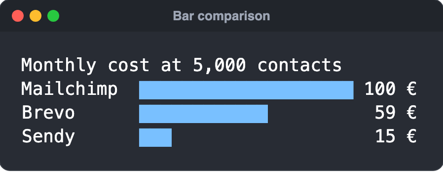<br><b>Bar comparison</b><br><sub>amounts side by side</sub></td>
<td width="33%">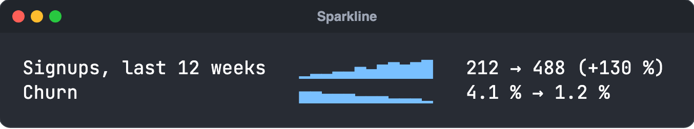<br><b>Sparkline</b><br><sub>a trend over time</sub></td>
<td width="33%">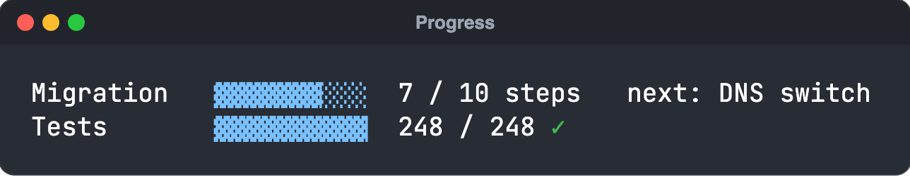<br><b>Progress</b><br><sub>how far a job is</sub></td>
</tr>
<tr>
<td>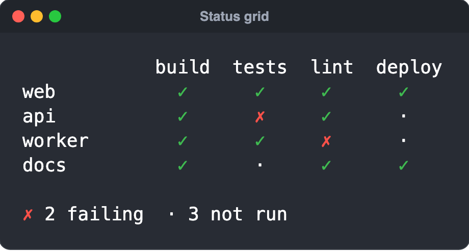<br><b>Status grid</b><br><sub>many items × few checks</sub></td>
<td>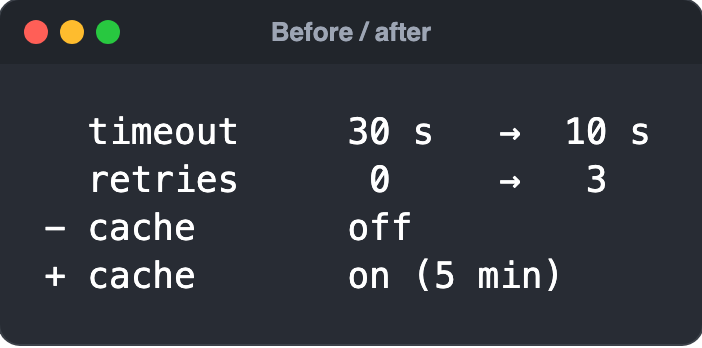<br><b>Before / after</b><br><sub>what changed</sub></td>
<td>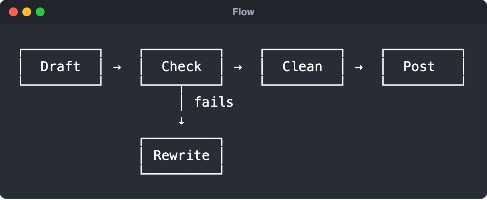<br><b>Flow</b><br><sub>steps, a pipeline</sub></td>
</tr>
<tr>
<td>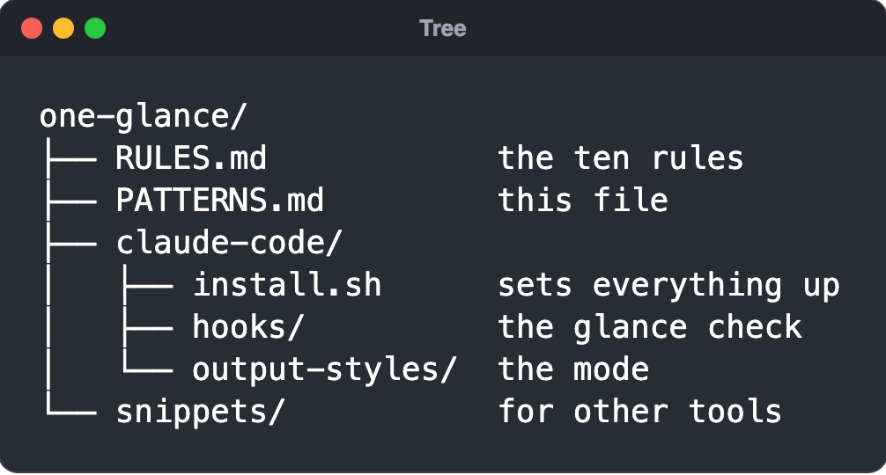<br><b>Tree</b><br><sub>hierarchy, folders</sub></td>
<td>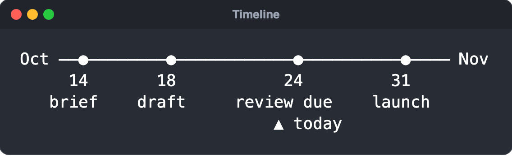<br><b>Timeline</b><br><sub>events, deadlines</sub></td>
<td>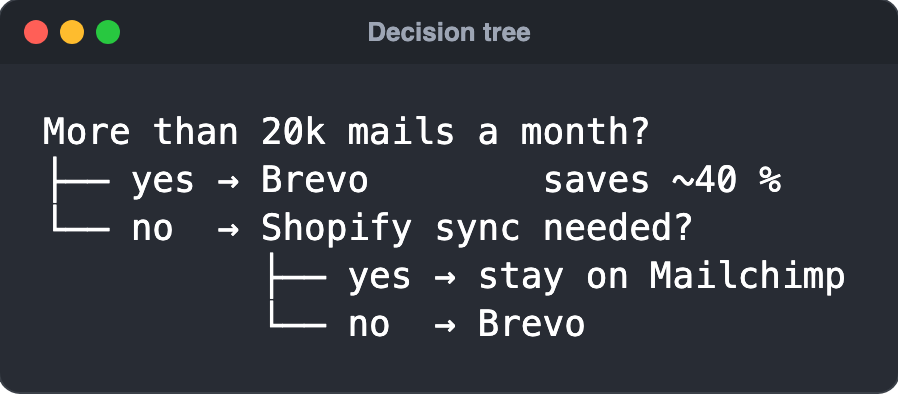<br><b>Decision tree</b><br><sub>if this, then that</sub></td>
</tr>
<tr>
<td>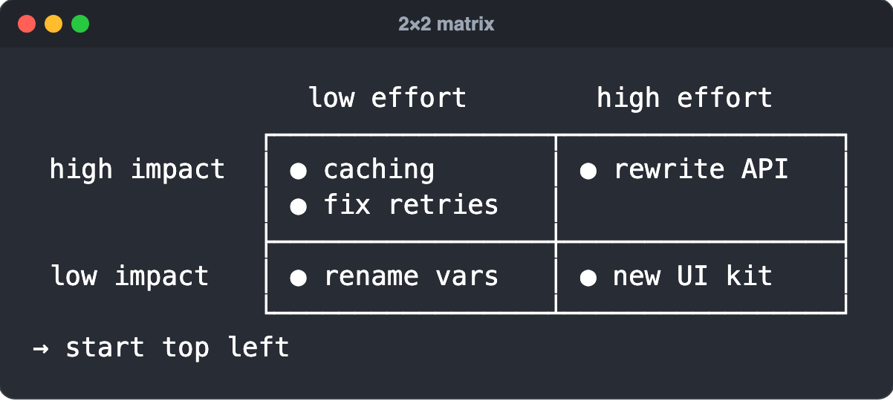<br><b>2×2 matrix</b><br><sub>items on two criteria</sub></td>
<td>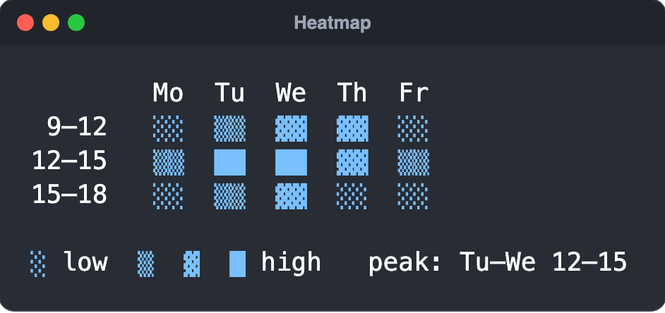<br><b>Heatmap</b><br><sub>intensity over two axes</sub></td>
<td>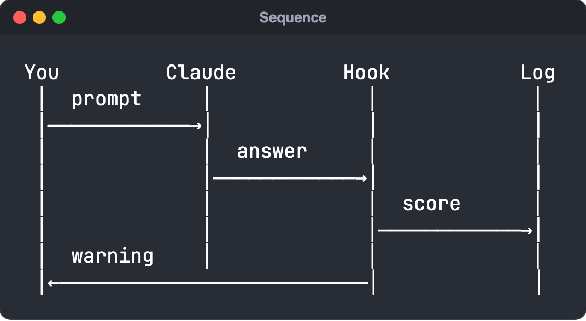<br><b>Sequence</b><br><sub>who talks to whom</sub></td>
</tr>
<tr>
<td>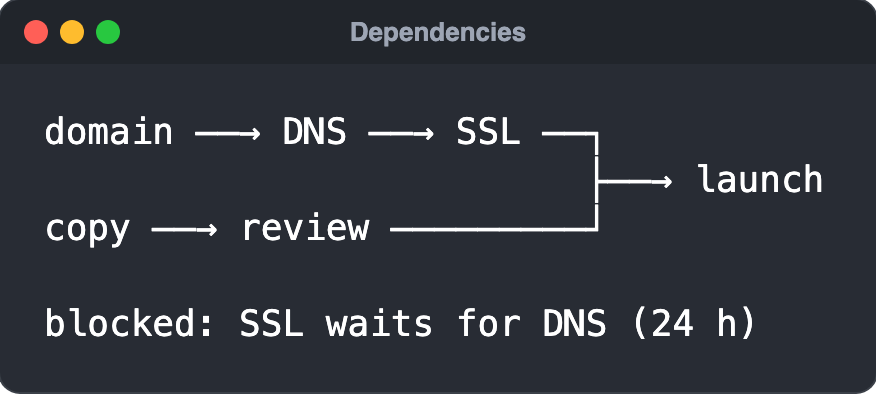<br><b>Dependencies</b><br><sub>what blocks what</sub></td>
<td>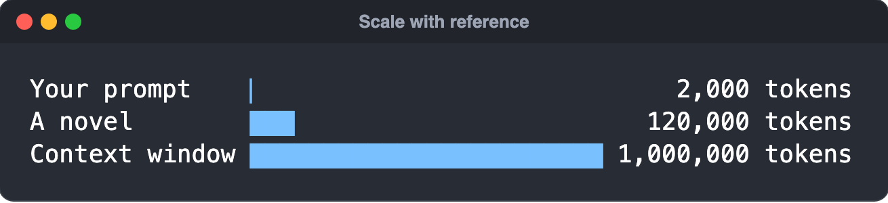<br><b>Scale with reference</b><br><sub>a size nobody can feel</sub></td>
<td>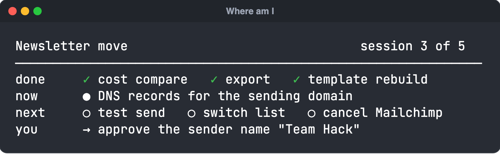<br><b>Where am I</b><br><sub>back to a session cold</sub></td>
</tr>
</table>

<sub>Screenshots are rendered from the examples in PATTERNS.md with `python3 tools/render_patterns.py`.</sub>

## Why five seconds

| Time | What a human gets |
|---|---|
| 0.05 s | first impression ([Lindgaard et al. 2006](https://doi.org/10.1080/01449290500330448)) |
| 0.25 s | colour, size, position pop out, before reading |
| 5 s | a glance: about 20 words at ~240 words a minute ([Brysbaert 2019](https://doi.org/10.1016/j.jml.2019.104047)) |
| 80 s | one 320-word answer, the default above |

## The test

Show the output to someone for five seconds. Ask two things:

1. What is the result?
2. What do I have to do?

Two right answers: pass. Anything else: rewrite. The ten rules behind it: [RULES.md](RULES.md). The first one carries most of the weight: **the answer comes first.**

## Use it elsewhere

| Where | File | How |
|---|---|---|
| Claude Code | [`claude-code/`](claude-code/) | `./claude-code/install.sh` |
| CLAUDE.md, AGENTS.md | [`snippets/CLAUDE.md`](snippets/CLAUDE.md) | Paste the block |
| Cursor | [`snippets/one-glance.mdc`](snippets/one-glance.mdc) | Copy to `.cursor/rules/` |
| Claude, ChatGPT, other chat apps | [`snippets/custom-instructions.md`](snippets/custom-instructions.md) | Paste into custom instructions |
| HTML page | [`templates/glance-page.html`](templates/glance-page.html) | Starting point when the terminal is not enough |

<details>
<summary><b>What the Claude Code installer sets up</b></summary>

1. **Output style `one-glance`** in `~/.claude/output-styles/`. Toggle with `/output-style`.
2. **The glance check**, a `Stop` and `UserPromptSubmit` hook in `~/.claude/hooks/one-glance/`. Scores go to `~/.claude/one-glance/log.jsonl`. Switch it off with `ONE_GLANCE_CHECK=off`.
3. **The pattern catalogue and HTML template** in `~/.claude/one-glance/`.

Your existing `settings.json` is kept and backed up as `settings.json.bak-one-glance`.

</details>

## Deutsch

Regeln auf Deutsch: [de/REGELN.md](de/REGELN.md).

## License

MIT
